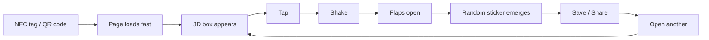
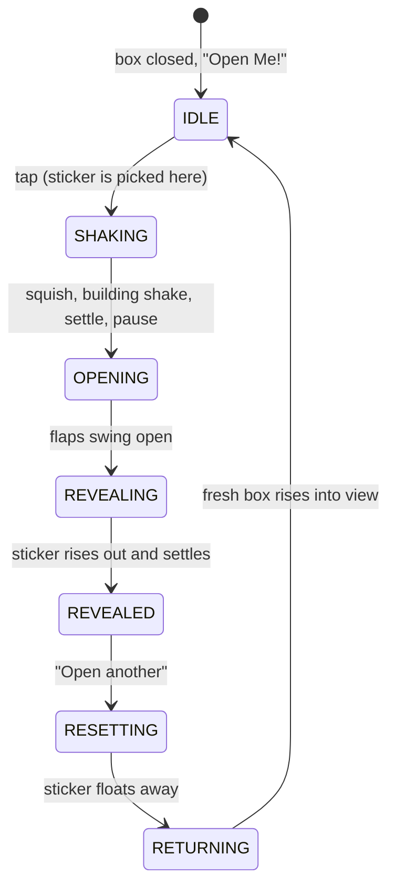
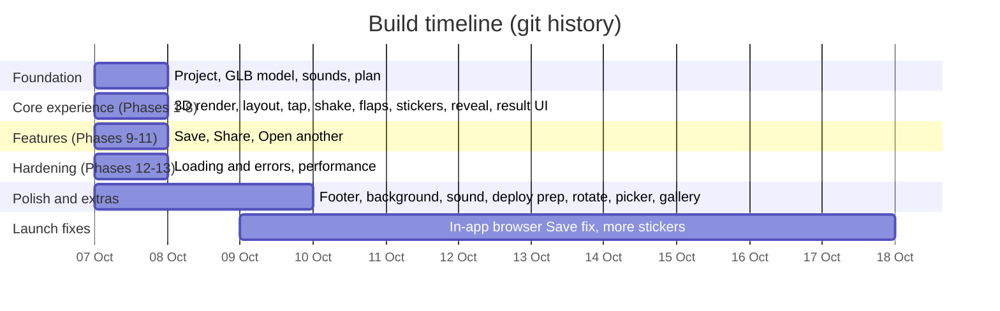
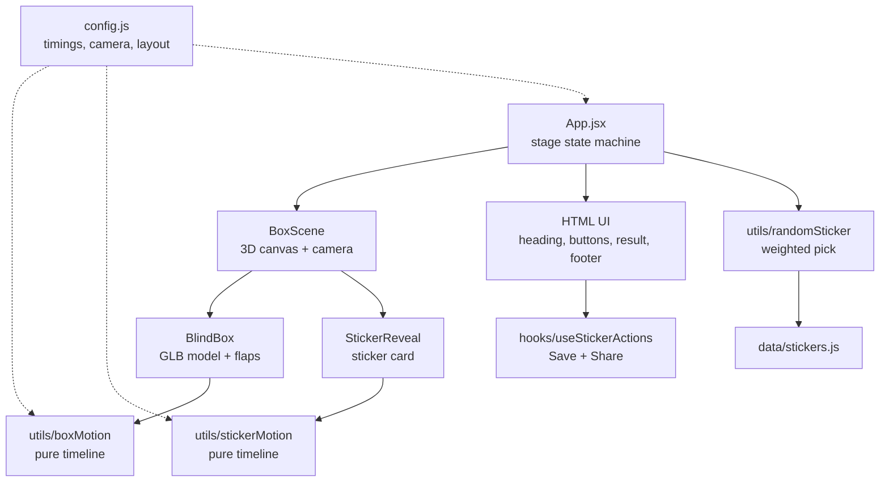

# Toffee Digital Blind Box 🐱📦

A mobile-first digital blind box. Tap the box, watch it shake and pop open, and a random sticker of my cat Toffee rises out. Save it, share it, or open another.

I love buying blind boxes when I'm stressed. This is the version I can open as often as I like without spending anything.

> Built with Vite, React, Three.js (React Three Fiber) and plain CSS. It is a static site with no backend, database or accounts.

---

## The idea

The goal was **not** a generic 3D website or a mobile game. It was to capture what opening a physical collectible feels like:



The plan was that someone taps an NFC tag or scans a QR code, often on mobile data, so every decision had to serve that journey: **fast to load, obvious what to do, satisfying to open**.

Design words I kept coming back to: *cute, collectible, tactile, playful, simple, slightly surprising.* Things I deliberately avoided: casino-style reveals, NFT/crypto aesthetics, heavy particle effects, and generic SaaS UI.

## Design process

### 1. Start from my own artwork
The visual identity comes from things I made, not generated placeholders:

- a hand-drawn blind-box schematic (`reference/`)
- the transparent PNG sticker art (`public/stickers/`)
- a 3D box model (`public/models/toffee_box.glb`) built from the schematic
- a pixel-art style for the buttons, font (Pixelify Sans) and backgrounds

The rule I set early: **the supplied artwork is the source of truth.** If code and artwork disagree, the code changes.

### 2. Make opening feel physical
The reveal is a timed sequence, not a fade:



Details that mattered:

- **Anticipation before action:** a small squish, then a shake that builds, then a pause before the lid opens.
- **Flaps open in order:** front and back first, then the sides, because the side flaps sit *under* the others in the model and clip if opened early.
- **The sticker physically comes out of the box:** it is a 3D card, so the box walls hide it while it's inside, then it rises, grows and rocks into place. It is never just a fade-in.
- **Camera helps tell the story:** it widens when the box opens and drifts so the sticker becomes the focus.
- **All timings live in one config** (`src/config.js`) so I can tune the pacing without hunting through code.
- **Reduced motion** gets a simpler, shorter version rather than a broken one.

### 3. Keep the UI out of the way
Big pixel-art buttons (47px+ tap areas), safe-area padding, `100dvh`, no hover-only interactions, no horizontal scroll. Checked at 375x667, 390x844, 430x932, 820x600 and 1280x800.

### 4. Small touches added after the core was done
- Drag to turn the closed box, with a "Rotate me!" hint that fades after first use
- Sound effects, with a mute toggle (saved between visits)
- A background picker (sky, cozy room, galaxy, meadow)
- An About panel with a swipe gallery

## How it was built

I worked in **14 small phases** and wasn't allowed to start a phase until the previous one worked. The plan lived in `CLAUDE.md` and I built it with [Claude Code](https://claude.com/claude-code) as a pair-programming partner. Each phase is one commit.



| Phase | What | Commit |
|---|---|---|
| 1 | Vite/React setup, 3D box renders | `1fa8f1a` |
| 2 | Responsive mobile layout, "Tap to open" | `9358e6d` |
| 3 | Tap interaction, double-tap lock, error boundary | `9d1a513` |
| 4 | Box shake with a configurable timeline | `6ee2581` |
| 5 | Flaps open in sequence, camera eases out | `798c889` |
| 6 | Sticker data and weighted random pick | `0fe7715` |
| 7 | Sticker rises out of the box | `5ffd489` |
| 8 | Result UI, pixel font and buttons | `5c19f1b` |
| 9 | Save the original PNG | `6f8a57a` |
| 10 | Native Share with Save fallback | `f983fdf` |
| 11 | Animated "Open another box" | `487c213` |
| 12 | Loading screen and error handling | `4f9bafe` |
| 13 | Performance | `b902aa0` |
| 14 | Production audit and deploy | in progress |

## Tech stack and why

| Choice | Why |
|---|---|
| **Vite** | Fast dev server and small, optimised static builds |
| **React 19** | Simple state for the stages above and the UI around the canvas |
| **Three.js + React Three Fiber** | A real 3D box with real flaps that physically open, in React components |
| **Plain CSS** | The UI is small; no UI framework needed |
| **Web Audio API** | Tight sound timing, works with no extra library |
| **Web Share API** | Native iPhone/Android share sheet with the real sticker file |
| **sharp** (dev only) | Builds small preview images at build time |
| **Vercel** | Static hosting with security headers and long-lived caching |

Deliberately **not** used: a backend, database, accounts, or animation libraries. The more I could leave out, the faster it loads.

## Architecture



Principles: data, randomisation, 3D, animation and UI stay in separate files. Motion is written as pure functions of time, so it is easy to tune and reason about.

**Adding a sticker** needs only the transparent PNG in `public/stickers/` and one entry in `src/data/stickers.js`. Weights are relative, so rarer stickers can be added later.

## Problems I ran into and how I solved them

- **Side flaps clipped through the box.** They sit under the front/back flaps, so they now open slightly later. I checked this numerically against the real model geometry.
- **Stickers were far bigger than they looked.** The PNGs are 3000x3000 with large uneven transparent margins, so I measure the *visible* artwork bounds to centre and size them.
- **3 MB of stickers on mobile data.** The on-screen reveal uses ~130 KB WebP previews. **Save and Share still use the untouched original PNG.** On a throttled 3G test, tap-to-sticker went from ~25s to ~6s.
- **Colours shifted when "optimising" PNGs.** The art is Display P3, and running it through a colour-managing tool silently changes pixels. So the originals ship as supplied.
- **Dropped a heavy dependency.** `@react-three/drei` was only used for two things, so I replaced them with a small loader and a tiny canvas shadow.
- **iPhone Share needs a synchronous call.** Safari rejects `navigator.share()` if you `await` first, so the file is prefetched while the sticker rises and share is called straight from the tap.
- **Save does nothing in in-app browsers** (LinkedIn, Instagram…). There it opens the share sheet, or falls back to press-and-hold, with a tip to open in Safari/Chrome.
- **The Open button jumped on press.** Centring it with `transform` clashed with the press animation. Rule learned: never position with `transform` if the element also gets a press transform.
- **Fairness.** The draw uses `crypto.getRandomValues`, captured once at load, and the sticker is fixed at tap time so double-taps can't reroll.

## Performance and resilience

- Loading screen is plain HTML/CSS in `index.html`, so it shows before any JavaScript arrives
- The model and Open button image are preloaded in parallel with the JS
- Device pixel ratio capped at 2; sticker textures uploaded to the GPU early to avoid stutter
- Handled gracefully: missing model, no WebGL, GPU context loss, a broken sticker image (a different one is picked), slow downloads, and no Share support
- Strict Content-Security-Policy and caching headers in `vercel.json`

## Accessibility

Keyboard-operable buttons with visible focus, `aria-label`s on image buttons, dialogs trap and restore focus, `role="status"` for the result, and a reduced-motion mode.

## Run it locally

```bash
npm install
npm run dev      # local dev server
npm run build    # production build (also makes sticker previews)
npm run preview  # try the production build
```

Requires Node 20.19+.

## Project structure

```
src/
├── App.jsx            stage state machine
├── config.js          all timings, camera and layout values
├── components/        BoxScene, BlindBox, StickerReveal, RevealResult, ...
├── data/              stickers, backgrounds, about text
├── hooks/             sounds, save/share, background, dialog focus
├── utils/             box + sticker motion, weighted random, save/share
└── audio/             Web Audio engine
public/                stickers, model, fonts, buttons, backgrounds
scripts/               build-time image preparation
reference/             original schematic (not shipped)
```

---

Made with love (and a shopping problem) by Alyssa, for Toffee.
